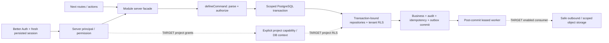

# Architecture — АМС Старт

**Статус:** Active
**Platform contract:** AMS Application Platform Core 3.4 — Solo Minimal

## Delivery and project profile

```text
REPOSITORY_ROLE = template
DELIVERY_PROFILE = COMMERCIAL
CANONICAL_PROVIDER = github
REPOSITORY_VISIBILITY = private
TENANCY = multi-tenant
ASYNC = outbox-plus-queue
DATA = pii
DELIVERY = own-saas
PLATFORM_ADMIN = enabled
```

This repository is a copy-source starter. It has no production users, host,
database, secrets or release authority. A pull request is never a release and
the owner has authorized phased autonomous merge of the approved hardening
program through protected PRs after review and successful exact-head checks.
This authorization never grants production authority. `REPOSITORY_VISIBILITY`
describes the final contract: public visibility is temporarily owner-approved
to unblock CI and must be restored to private after full-program verification.

## Source of truth

| Area | Authoritative source |
| --- | --- |
| Product scope | `01_PRD.md` |
| Screens, routes and flows | `02_PRODUCT_STRUCTURE.md` |
| Architecture, profile, security and data policy | this file and ADRs |
| Current schema and migrations | `prisma/schema.prisma`, `prisma.config.ts`, `prisma/migrations/` |
| Current work | `04_BACKLOG.md`; execution state is local Backlog, excluded from product copies |
| Release template | `05_RELEASE_CHECKLIST.md`, Docker/Compose and `ops/` |
| Final conformance and derived handover | `HANDOVER.md` and ADR-014 |
| Exact versions | `package.json`, `pnpm-lock.yaml`, `.node-version`, Dockerfile |

The detailed `AUTH.md`, `DATA_MODEL.md`, `SECURITY.md`, `ENVIRONMENT.md`,
`RUNBOOK_DEPLOY.md`, `ops/*` and two design-system documents remain justified
extensions. They refine the area named here and cannot override it.

## GitHub delivery contract

The owner approved `template` and `COMMERCIAL` as independent classifications.
GitHub is primary, canonical branch is `main`; SourceCraft is an optional
one-way mirror with no independent CI or release authority. See ADR-015.
Legacy SourceCraft/EXPERIMENT decisions are superseded for current delivery.

Runtime is Node **24.20.0** and pnpm **11.5.1**, installed from the frozen
lockfile. The reusable verifier is pinned to reviewed
`neyro-level/AMS_DELIVERY_CORE` revision
`a39227c11a017bf126d3ba416f8dd5da7ff24449`. The consumer calls the byte-exact
local vendor `.github/workflows/ams-verify.yml`; its companion provenance lock
and policy validator bind both source SHA and checksum. Public callers cannot
use a private cross-repository workflow. This Delivery Core vendor mechanism
works with either visibility without publishing the shared repository.
The consumer binds `expected_sha`
to the current PR head (or canonical push SHA); it must check out that exact
commit with read-only permissions and no inherited secrets. Required context
is `commercial-gate / verify`, including an always-running failure gate.

The project contract preserves quick/config/architecture checks, unit and
security tests, secret scanning, native PostgreSQL 18 foundation/auth/RLS/
atomicity/outbox proof, worker build/smoke, GitHub-only clean-room derivation,
browser checks and build. Security
and dependency scans remain relevant proof for shipped artifacts. Disposable
test resources use literal loopback and dedicated test identities; production
credentials, managed databases and production runners are excluded. A static
SourceCraft policy PASS or local build does not satisfy this provider gate.
Protection and successful provider runs require actual API readback; workflow
presence is not evidence. For the approved program, the executor merges each
reviewed green exact-head PR without another permission request, verifies the
resulting main SHA and checks, then starts dependent epics. Direct pushes to
main, force pushes and protection bypass are forbidden. Production remains
separately authorized; derived products establish their own merge permission.

Permanent template docs retain architecture, security, UI, derivation and
technical acceptance instructions. Task queues, master-plans, wave inventories
and execution snapshots are not inherited product content. Unique long-term
decisions must be preserved here or in ADRs before legacy history is removed.
Client facts, offers, SEO and production identity belong to each derived product.

## Modular monolith

| Module | Owns | Public boundary |
| --- | --- | --- |
| `identity-access` | users, memberships, auth administration | server facade and contracts |
| `project-registry` | neutral tenant project registry | server facade and DTOs |
| `platform-operations` | audit, idempotency, outbox, jobs, readiness | server facade and worker contracts |
| `notifications` | notification feed/read state | server facade and DTOs |
| `platform-admin` | platform-wide summaries and operations UI | explicit admin presentation boundary |
| `platform/*` | database, commands, auth, authorization, config, observability | platform-owned server APIs |

Presentation calls a module facade. Application code uses ports and DTOs;
Prisma stays in `platform/database` and module infrastructure. External side
effects stay outside a business transaction.

## Data, tenancy and async direction

The selected profile is intentional: a shared deployment can serve independent
organizations and needs an explicit tenant principal, server-owned organization
context, scoped repositories, tenant-aware constraints and isolation tests.
RLS is additional PostgreSQL protection, not a replacement for authorization.
`VERIFIED` source: transaction-local context and tenant coverage already exist
in `platform/database` and forward migrations. Future project grants and
within-organization project RLS are TARGET, not proven by tenant isolation.

`outbox-plus-queue` is retained because durable business delivery, replay and
integration journaling are target guarantees. The starter ships a neutral,
disabled-by-deployment worker foundation; a derived product enables it only
after adding an owned async consumer contract. Outbox payloads are minimal,
versioned and secret/PII-safe; external delivery is after commit.

## Runtime boundaries and implementation state

`VERIFIED` below means source exists; each changed contract still requires its
matching exact-SHA checks. `EXISTS` is implemented source, `CONFIGURE` is a
product-owned input, `BUILD` is a target capability, `VERIFY` is missing or
repeatable evidence, `DEFER` is outside the reusable foundation.



Query facades also use authorized transactions; they do not all invoke a
mutation command. Source owners: `platform/auth/principal-session.ts`,
`authorization/principal-factories.ts`, `commands/define-command.ts`,
`database/transaction.ts`, `database/scoped-db.ts`, module infrastructure and
`worker/main.ts`. The dashed paths are targets, not existing transport APIs.

| Contract | Class | Actual source / boundary and required proof |
| --- | --- | --- |
| Better Auth and fresh principal | EXISTS + VERIFY | auth.ts and principal-session.ts disable cookie-cache, reload persisted expiry/user/org/MFA; native disabled/revoked/setup/MFA denies and complete browser flow |
| organization context | EXISTS + VERIFY | activeOrganizationId setter validates session/membership; multiple memberships have no implicit first tenant; switcher UI BUILD |
| system and tenant permissions | EXISTS | principal.ts and module authorization own current PLATFORM_ADMIN/STAFF/MEMBER and ORG_OWNER/ORG_MEMBER/VIEWER semantics; server checks precede data access |
| tenant RLS and safe runtime identities | EXISTS + CONFIGURE + VERIFY | transaction sets parameterized local principal/actor/org/correlation; declared nine-model coverage and policies; each product supplies non-owner NOBYPASSRLS web/worker roles, migrator separate |
| project membership/capabilities/context | BUILD + VERIFY | additive neutral grants/capabilities and project-owned policy, never donor domain roles; context cannot trust browser projectId; cross-project native denial mandatory |
| command atomicity | EXISTS + VERIFY | parse/authorize before scoped transaction; module repositories bind that transaction; business/audit/idempotency/outbox rollback together; no nested independent transaction or external I/O |
| outbox/queue worker | EXISTS + CONFIGURE + VERIFY | versioned event, leases/retry/dead-letter/recovery, worker entrypoint; product selects own consumers and retention, restart/disabled tests required |
| typed SecretRef/redaction | REUSE + BUILD + VERIFY | server-only environment SecretRef resolves late and masks reference/status serialization; client import guard is implemented; integrated adversarial structured-log redaction remains target, resolved raw values never become DTO/log/argv |
| safe outbound | BUILD + CONFIGURE + VERIFY | disabled by default, product-owned allowlist, DNS/IP/rebinding/redirect limits, timeout/size budget and safe errors; no inherited provider credentials |
| scoped S3/object storage | BUILD + CONFIGURE + VERIFY | optional adapter, neutral project key/metadata ownership, bounded signed access and cross-project denial; no starter bucket/endpoint is live |
| PWA/public/private shell | EXISTS + VERIFY | globals/primitives/routes and SW private exclusions; authenticated/post-logout/offline/noindex/cache browser proof |
| derivation distribution | EXISTS + BUILD + VERIFY | typed identity and exact-SHA generator omit task/plans/history; deterministic copies, residue/profile negatives and disposable native/browser proof; independent domain pilot remains target |
| GitHub merge gate | EXISTS + VERIFY | ADR-015, local byte-exact shared vendor/provenance, exact-head app checks and strict protected main; configuration and provider success are distinct |
| immutable artifacts/recovery recipes | EXISTS + CONFIGURE + VERIFY | Docker/Compose/release/backup scripts; product-owned paths/roles/digests; disposable restore, rollback and non-root artifact inspection required |
| live provider domain, billing, public signup, production | DEFER | derived product scope/explicit contract; no automatic inclusion or delivery authority |

## Minimal runtime and optional boundaries

The base is Next web plus PostgreSQL, with Better Auth and the module monolith.
No broker, S3, external provider or live HTTP consumer is a mandatory core
service. pg-boss uses PostgreSQL; the worker is a separate process only when a
product chooses async work. `EXISTS` worker tooling is not an enabled production
consumer. Optional-module decisions are explicit in the identity/derivation
contract. ProjectIdentityV2 has explicit defaults: outbox/PWA/platformAdmin
enabled, outbound/objectStorage disabled. The strict platform/config validator
owns server identity; RootLayout passes only its whitelisted public DTO to
client labels. See DERIVATION for fields/inputs. Only explicit enabled activates a module. Core optional route/action/worker
guards deny execution before data or DB work; generated infrastructure omits
disabled worker/maintenance. DERIVATION owns applicable profile proof. Each
product reruns it; configuration alone never proves its selected runtime.

`TARGET`: disabled optional HTTP/storage/consumer APIs fail closed with a typed
safe result and require no configured external endpoint. Disabled data paths
must be checked as well as enabled positive scenarios. No fallback may silently
create a real provider request, use a public shared bucket or unscoped project.

## Extension and deployment boundary

A derived product adds domain modules through existing facades/ports, DTOs,
commands and transaction-bound repositories; new tenant/project-owned tables
require policy/coverage/native negative tests in the same change. Its optional
provider adapters resolve owned credentials server-side and run external I/O
outside the business transaction. Copying a donor migration, auth framework,
legal identity or production adapter is outside this architecture contract.

Docker/Compose/systemd/Nginx are reusable packaging recipes, not current
production topology. Web/worker/migrator/backup roles and secrets are distinct;
only migrator receives DDL. Connection budgets, proxy CIDRs, release/artifact
identity, offsite backup and legal retention belong to the derived product.
[ENVIRONMENT.md](ENVIRONMENT.md) owns variable names/conditions without values;
[05_RELEASE_CHECKLIST.md](05_RELEASE_CHECKLIST.md) owns acceptance statuses;
[RUNBOOK_DEPLOY.md](RUNBOOK_DEPLOY.md) and [ops/RECOVERY.md](ops/RECOVERY.md)
own procedures. Production and live data are separately authorized.

## PII lifecycle

| Concern | Starter policy | Derived product obligation |
| --- | --- | --- |
| Inventory | account, membership, audit, notification and configured contact data are PII candidates | add domain fields before production |
| Access | server authorization; Platform Admin is explicit | define role/resource policy |
| Masking and logs | no secrets in browser/logs; avoid unnecessary PII in events | define field-level masking |
| Retention | operation records have retention boundary | set lawful durations and job policy |
| Export/deletion | no generic export/delete API is implied | define product flow and legal basis |
| Audit | security and significant admin operations are auditable | extend action taxonomy |
| Backup | starter has no production backup | define backup retention, restore owner and proof |

Legal requirements remain `REQUIRES_CHECK`; this matrix is an engineering
contract, not legal advice.

## Version matrix and verified exceptions

| Area | Installed exact version | Decision |
| --- | --- | --- |
| Node.js | 24.20.0 | Node 24 line; project exact version is pinned |
| Next.js | 16.3.8 | installed App Router line; package.json/lockfile own exact pin |
| React | 19.2.8 | compatible project line |
| Prisma / adapter | 7.10.0 / `@prisma/adapter-pg` 7.10.0 | supported PostgreSQL adapter pattern |
| PostgreSQL target | 18 | target line; native guarded test target; no starter production database |
| Better Auth | 1.7.2 | plugin configured in auth.ts; server MFA guards exist, complete UI requires proof |
| pg-boss | 12.30.0 | PostgreSQL queue; schema migration/runtime privileges stay separate |
| TypeScript | 6.0.3 | explicit project exception to Core 3.4's 5.9.x hold; no upgrade is implied |

Historical compatibility references recorded on 2026-09-24, retained for
reproducibility. Installed versions above come from the current lockfile;
these references alone do not establish current provider/runtime compatibility:

- Next.js 16 upgrade/proxy guidance: <https://nextjs.org/docs/app/guides/upgrading/version-16>;
- Prisma 7 PostgreSQL adapter: <https://www.prisma.io/docs/orm/v7/core-concepts/supported-databases/postgresql>;
- Better Auth two-factor plugin: <https://better-auth.com/docs/plugins/2fa>;
- PostgreSQL 18 row security policies: <https://www.postgresql.org/docs/18/ddl-rowsecurity.html>;
- pg-boss runtime and queue contract: <https://github.com/timgit/pg-boss>;
- TypeScript 6 release notes: <https://www.typescriptlang.org/docs/handbook/release-notes/typescript-6-0.html>.

The TypeScript 6 exception is observational: it is retained because the exact
project toolchain is already pinned and no incompatible API has been found in
this scope. A downgrade or further major migration is a separate RISKY task,
not an incidental hardening change.

## ADRs and revisit triggers

- ADR-001 fixes the application-platform profile.
- ADR-002 fixes the neutral hardening boundary and traceability.
- Revisit tenancy/RLS with new project-grant/native-negative proof; queue
  deployment requires an owned consumer and restart/disabled proof.
- Revisit TypeScript only through a separately approved version task.

Dependency security pins: `fast-uri` 3.1.8 and `source-map-js` 1.2.2 patch
their audited URI/source-map defects. `sharp` 0.35.5 pins Next's optional
0.35 range to obtain patched librsvg; its Node requirement remains compatible.
Frozen installation, build and image-transform regression must prove this
bounded patch override before the updated artifact is accepted. Next and
`eslint-config-next` move together to 16.3.8; other direct runtime pins stay.
